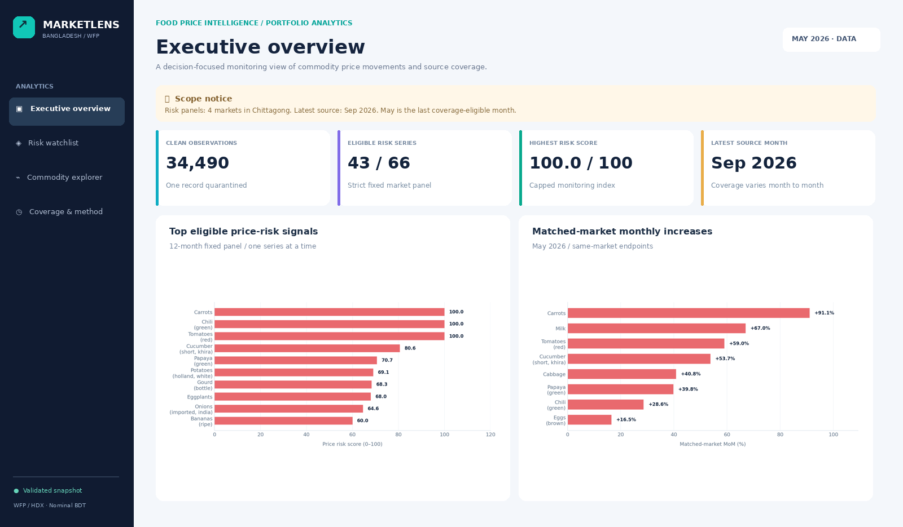
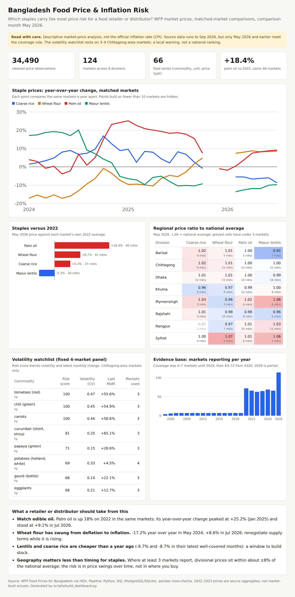

# Bangladesh Food Price & Inflation Risk Analysis

## Portfolio showcase — start here

**Explore the deliverables**

- [**Interactive MarketLens dashboard**](dashboards/interactive_dashboard.html) — self-contained offline HTML with overview, watchlist, commodity explorer, and coverage views. Download and double-click the HTML; GitHub renders only its source code.
- [**Case study**](case-study.html) — a professional long-form HTML project story with problem, pipeline, findings, recommendations, and limitations.
- [**Five-page analytical report (PDF)**](showcase/Food_Price_Analysis_Report.pdf) — evidence-backed figures, business recommendations, and methodological boundaries.
- [**Native Power BI project (.pbip) source**](powerbi/Bangladesh_Food_Price_Intelligence.pbip) — generated report pages and embedded real-data snapshot. **Requires Power BI Desktop opening and visual checks on Windows**; no pretested `.pbix` is claimed. Read [Power BI startup guide](powerbi/README_FIRST.md).
- [**Existing dashboard**](dashboards/food_price_dashboard.html) and [**Power BI manual-build guide**](dashboards/POWERBI_GUIDE.md) — original pipeline resources remain available.

> **Publication scope:** The comparison snapshot is May 2026. The source has later observations through September 2026, but those fail the documented coverage threshold. Risk rankings use four markets in the Chittagong area; they are **not nationwide risk estimates**. Figures are nominal BDT, not official CPI, forecasts, or demonstrated business outcomes.

### Architecture at a glance

`WFP CSV (manual download) → Python profiling & cleaning → SQL star schema → 12 validated analyses → risk/price/coverage exports → Power BI project + HTML dashboard + portfolio report`

**To regenerate the extended showcase after supplying the CSV:** double-click `run_all.bat` first, then double-click `build_showcase.bat`. To update just the interactive HTML: `python -m scripts.build_portfolio_showcase`. To rebuild the Power BI `.pbip` snapshot: `python -m scripts.build_powerbi_project`. To rebuild the PDF and case study: `python -m scripts.build_case_study`. The HTML and PDF snapshot files bundled here are viewable without the raw dataset.

---

**Business question:** Which food commodities and regions in Bangladesh carry the highest price risk for a food retailer or distributor, and what should they do about it?

An end-to-end analytics project: WFP market prices (34,490 cleaned observations, 124 markets, 2005–2026) → Python cleaning → PostgreSQL/SQLite star schema → 12 SQL analyses → independent validation → dashboard. This is descriptive market-price analysis, not Bangladesh's official inflation rate (CPI).

**Interactive dashboard:** open [`dashboards/food_price_dashboard.html`](dashboards/food_price_dashboard.html) in any browser (single file, no server needed). Rebuild it with `python -m scripts.build_dashboard`.

## Key findings (included run: comparison month May 2026, data to Sep 2026)
- **Palm oil is the biggest staple price risk.** Up 18.4% on 2022 in the same 46 markets; year-over-year change peaked at +25.2% (Jan 2025) and was +9.1% in Jul 2026.
- **Wheat flour swung from deflation to inflation:** -17.2% year over year in May 2024, +8.6% in Jul 2026.
- **Masur lentils and coarse rice are cheaper than a year ago** (-9.7% and -8.7% in Jul 2026).
- **For staples, timing matters more than geography.** Where at least 3 markets report, divisional prices sit within about ±8% of the national average.

## Limitations that matter
- The 12-month volatility watchlist uses a fixed panel of only **3–4 Chittagong-area markets**. Treat it as a local warning, not a national ranking.
- The comparison month is **May 2026**, not the latest month (Sep 2026): later months fail the broad-coverage rule (too few series or markets reported).
- 2022–2023 prices are source **aggregates**; 2024 onward are mostly actual market observations. Matched-market comparisons reduce, but do not remove, this measurement change.
- Seasonality is shown in the data tables only; most series have a single complete year.
## Start here (Windows)
1. Extract this entire ZIP to a writable folder such as `Documents/food-price-project`. Do not run inside the ZIP.
2. Install Python 3.10+ with **Add Python to PATH** checked. Install PostgreSQL and pgAdmin for the primary database path.
3. In pgAdmin connect to your local server, right-click **Databases → Create → Database**, enter `food_prices`, and Save. Use a dedicated database: the pipeline recreates its four project tables, configuration table and views.
4. Copy `.env.example` to `.env` (no credentials are bundled). In Windows File Explorer select **View → Show → File name extensions** to avoid `.env.txt`. Fill the PostgreSQL password, user, host and port. Choose `DB_BACKEND=postgres` for strict PostgreSQL, `auto` for PostgreSQL with logged fallback, or `sqlite` for no-server use.
5. Download the CSV from [WFP Bangladesh Food Prices on HDX](https://data.humdata.org/dataset/wfp-food-prices-for-bangladesh) and save exactly one CSV in `data/raw/` (raw data is not committed to Git). If the link changes, search HDX for that title and choose the WFP publisher. Record the download date and source license in `docs/SOURCE_NOTES.md`.
6. Double-click `run_all.bat`. On the first run it creates `.venv`, installs requirements, copies `.env.example` if needed and executes everything. Internet is needed for package installation, not for processing the CSV.
7. Wait for **SUCCESS**. Open `docs/FINDINGS.md` in VS Code (Ctrl+Shift+V to preview Markdown), then `outputs/tables/` and `outputs/charts/`.
8. Open `dashboards/food_price_dashboard.html` (built automatically by the pipeline). To rebuild it in Power BI or Looker Studio, follow `dashboards/POWERBI_GUIDE.md` or `dashboards/LOOKER_STUDIO_GUIDE.md`.

For a terminal run: `python -m pip install -r requirements.txt`, then `python run_all.py`. For tests: `python -m pytest -q`. These commands run from the project root. Individual scripts expose `run()` functions and are orchestrated by `run_all.py`.

## What each folder does
| Path | Purpose |
|---|---|
| config.py | All source column mappings, date format, explicit aliases and risk parameters |
| scripts/profile_data.py | Shape, raw types, missingness, dates, categories, duplicates and dictionary |
| scripts/clean_data.py | Conservative cleaning, rejected rows, retained outlier flags and change log |
| scripts/load_to_db.py | Constrained star schema, coverage-based comparison month, transactional refresh and exports |
| sql/analysis_queries.sql | Twelve named SQL analyses with matched/fixed-market comparisons |
| scripts/run_analysis.py | Runs every SQL query and exports results and checks |
| scripts/validate_outputs.py | Independently checks every matched change and risk score against cleaned records |
| scripts/make_charts.py | Six real-data figures with coverage and geographic caveats |
| scripts/build_dashboard.py | Builds the single-file HTML dashboard (inline SVG, no JavaScript) from `outputs/tables` |
| scripts/generate_report.py | Real-data findings and this README's results section |
| data/raw | Your original source, never modified |
| data/processed | Clean records and rejected records for audit |
| outputs/tables | Twelve analysis CSVs, four model tables, panel membership, coverage, profiling and verification CSVs |
| outputs/charts | Six generated PNGs |
| dashboards | HTML dashboard + preview image; optional Power BI / Looker Studio build guides |
| docs | Methodology, data dictionary, cleaning log, source notes, validation record |
| tests | Synthetic test data only; never used as portfolio evidence |

## Dependencies
| Package | Why it is needed |
|---|---|
| pandas | Load, profile and clean CSVs; prepare/export analysis tables |
| SQLAlchemy | One safe database connection/query interface for both engines |
| psycopg2-binary | PostgreSQL database driver |
| matplotlib | Save static charts without needing a GUI |
| python-dotenv | Load local credentials from `.env` |
| pytest | Run small reproducible correctness tests |

No web scraping, machine learning, dashboards-as-code dependency, or paid service is required. `requirements.txt` uses bounded compatible ranges, not a claim of permanently reproducible package resolution. Record installed versions with `python -m pip freeze` if you publish a final run.

## Analytical safeguards
Compare one commodity-unit-price-type series at a time. Price changes match the same markets at both endpoints; long-run lines use one fixed market. Risk scores require identical markets in all twelve months, with history restricted to 2024 onward. The latest source month and selected broad-coverage comparison month are separate. Food analyses exclude non-food, retain price-outlier flags and disclose aggregate source flags. **Read the risk-panel geography and sizes before treating a score as representative.** See `docs/METHODOLOGY.md`.

## Results
<!-- RESULTS_START -->
### Computed results

Generated UTC: 2026-10-31T17:33:52.820794+00:00. Latest source month: **2026-09-01**. Comparison month: **2026-05-01**, selected by **latest month meeting both trailing-12-month coverage thresholds**. The coverage rule requires at least 50% of each trailing-year maximum for food-series count and market count. This is an explicit heuristic, not a source completeness guarantee.

Cleaned observations: **34,490** from **34,491** source records; **33,648** cleaned food records. The raw inventory contains **843** non-food records. **1** records were quarantined. Eligible food-risk series: **43 of 66**. Ineligible does not mean low risk.

## Coverage near the source endpoint

| month_id | series | markets | broad_coverage | month |
| --- | --- | --- | --- | --- |
| 24310 | 54 | 53 | True | 2025-10-01 |
| 24311 | 47 | 4 | False | 2025-11-01 |
| 24312 | 52 | 52 | True | 2025-12-01 |
| 24313 | 48 | 48 | False | 2026-01-01 |
| 24314 | 51 | 52 | True | 2026-02-01 |
| 24315 | 50 | 52 | True | 2026-03-01 |
| 24316 | 49 | 52 | True | 2026-04-01 |
| 24317 | 53 | 98 | True | 2026-05-01 |
| 24318 | 19 | 92 | False | 2026-06-01 |
| 24319 | 20 | 95 | False | 2026-07-01 |
| 24320 | 1 | 75 | False | 2026-08-01 |
| 24321 | 2 | 14 | False | 2026-09-01 |

## Highest eligible food-risk scores (fixed markets, 2024 onward)

| commodity | unit | pricetype | month | market_count | available_markets | cv | mom_pct | risk_score | status |
| --- | --- | --- | --- | --- | --- | --- | --- | --- | --- |
| carrots | kg | retail | 2026-05-01 | 3.00 | 4.00 | 0.44 | 58.62 | 100.00 | eligible |
| chili (green) | kg | retail | 2026-05-01 | 3.00 | 91.00 | 0.45 | 54.94 | 100.00 | eligible |
| tomatoes (red) | kg | retail | 2026-05-01 | 3.00 | 4.00 | 0.47 | 55.56 | 100.00 | eligible |
| cucumber (short, khira) | kg | retail | 2026-05-01 | 3.00 | 4.00 | 0.20 | 65.12 | 80.62 | eligible |
| papaya (green) | kg | retail | 2026-05-01 | 3.00 | 83.00 | 0.15 | 28.59 | 70.67 | eligible |
| potatoes (holland, white) | kg | retail | 2026-05-01 | 4.00 | 7.00 | 0.33 | 4.53 | 69.06 | eligible |
| gourd (bottle) | kg | retail | 2026-05-01 | 3.00 | 20.00 | 0.14 | 22.14 | 68.34 | eligible |
| eggplants | kg | retail | 2026-05-01 | 3.00 | 4.00 | 0.21 | 12.68 | 67.97 | eligible |
| onions (imported, india) | kg | retail | 2026-05-01 | 3.00 | 4.00 | 0.28 | 3.97 | 64.61 | eligible |
| bananas (ripe) | 1 piece | retail | 2026-05-01 | 3.00 | 19.00 | 1.60 | 0.00 | 60.00 | eligible |

## Geography represented by the fixed risk panels

| division | district | market | eligible_series |
| --- | --- | --- | --- |
| chittagong | chittagong | bhashan char | 13 |
| chittagong | cox's bazar | cox`s bazar sadar | 38 |
| chittagong | cox's bazar | teknaf market | 40 |
| chittagong | cox's bazar | ukhia market | 37 |

**Risk-panel geographic scope: chittagong. These panels contain 4 distinct markets in total; they are not nationally representative.**

Score uses the same markets in all twelve months. CV is a fraction; MoM is percent. A high score from one market is a local warning, not a national commodity ranking. Series without the required panel are excluded from scoring.

## Biggest matched-market monthly increases at comparison month

| commodity | unit | pricetype | month | mom_pct | mom_markets | yoy_pct | yoy_markets | yoy_flag_transitions |
| --- | --- | --- | --- | --- | --- | --- | --- | --- |
| carrots | kg | retail | 2026-05-01 | 91.11 | 4 | 24.32 | 3 | 0 |
| milk | l | retail | 2026-05-01 | 67.01 | 4 | 68.75 | 4 | 0 |
| tomatoes (red) | kg | retail | 2026-05-01 | 58.97 | 4 | 77.14 | 4 | 0 |
| cucumber (short, khira) | kg | retail | 2026-05-01 | 53.73 | 4 | 39.19 | 4 | 0 |
| cabbage | kg | retail | 2026-05-01 | 40.85 | 3 | 0.00 | 1 | 0 |
| papaya (green) | kg | retail | 2026-05-01 | 39.81 | 49 | 11.34 | 48 | 0 |
| chili (green) | kg | retail | 2026-05-01 | 28.62 | 52 | 54.45 | 52 | 0 |
| eggs (brown) | 1 piece | retail | 2026-05-01 | 16.47 | 46 | -39.92 | 46 | 0 |
| eggs (white) | 1 piece | retail | 2026-05-01 | 15.38 | 4 | 5.88 | 4 | 0 |
| eggplants | kg | retail | 2026-05-01 | 9.47 | 4 | 44.44 | 4 | 0 |

## Biggest matched-market monthly decreases at comparison month

| commodity | unit | pricetype | month | mom_pct | mom_markets | yoy_pct | yoy_markets | yoy_flag_transitions |
| --- | --- | --- | --- | --- | --- | --- | --- | --- |
| bananas (green) | 1 piece | retail | 2026-05-01 | -19.05 | 3 | 12.50 | 4 | 0 |
| turmeric (powder, fresh) | kg | retail | 2026-05-01 | -18.02 | 4 | -22.92 | 4 | 0 |
| chickpeas | kg | retail | 2026-05-01 | -17.03 | 4 | -11.30 | 4 | 0 |
| lemon (medium size) | 1 piece | retail | 2026-05-01 | -16.36 | 4 | 4.55 | 4 | 0 |
| rice (brri-49) | kg | retail | 2026-05-01 | -10.16 | 3 | -13.21 | 2 | 0 |
| garlic (imported, china) | kg | retail | 2026-05-01 | -7.68 | 34 | -21.33 | 33 | 0 |
| meat (beef) | kg | retail | 2026-05-01 | -6.12 | 3 | 0.00 | 3 | 0 |
| snake gourd | kg | retail | 2026-05-01 | -5.17 | 29 | 31.12 | 27 | 0 |
| ginger (imported) | kg | retail | 2026-05-01 | -4.17 | 2 | 7.81 | 2 | 0 |
| rice (brri-29) | kg | retail | 2026-05-01 | -3.93 | 2 | -12.70 | 2 | 0 |

MoM and YoY use separate endpoint-matched market sets. The latest price in the MoM calculation can therefore differ from that in the YoY calculation. YoY requires the same market at both endpoints and at least twelve observed months through the current month. It does not imply every intervening month is present. Source-flag transitions are disclosed and are a remaining measurement limitation.

## Within-series division extrema (first ten rows, full table exported)

| commodity | unit | pricetype | month | division | position | avg_price | markets |
| --- | --- | --- | --- | --- | --- | --- | --- |
| bananas (ripe) | 1 piece | retail | 2026-05-01 | chittagong | highest | 10.02 | 8 |
| bananas (ripe) | 1 piece | retail | 2026-05-01 | khulna | lowest | 5.44 | 2 |
| chili (green) | kg | retail | 2026-05-01 | sylhet | highest | 106.38 | 7 |
| chili (green) | kg | retail | 2026-05-01 | rangpur | lowest | 68.45 | 12 |
| eggs (brown) | 1 piece | retail | 2026-05-01 | sylhet | highest | 11.80 | 7 |
| eggs (brown) | 1 piece | retail | 2026-05-01 | rangpur | lowest | 11.15 | 12 |
| fish (live, pangasius) | kg | retail | 2026-05-01 | khulna | highest | 241.62 | 2 |
| fish (live, pangasius) | kg | retail | 2026-05-01 | chittagong | lowest | 186.91 | 11 |
| garlic (imported, china) | kg | retail | 2026-05-01 | rangpur | highest | 205.00 | 1 |
| garlic (imported, china) | kg | retail | 2026-05-01 | mymensingh | lowest | 139.78 | 2 |

## Core staples versus 2022: matched markets only

| series_id | commodity | unit | pricetype | month | matched_markets | baseline_2022 | current_price | min_baseline_months | max_baseline_months | baseline_aggregate_pct | change_pct |
| --- | --- | --- | --- | --- | --- | --- | --- | --- | --- | --- | --- |
| 43 | oil (palm) | l | retail | 2026-05-01 | 46.00 | 142.33 | 168.59 | 2.00 | 12.00 | 100.00 | 18.45 |
| 78 | wheat flour | kg | retail | 2026-05-01 | 41.00 | 50.79 | 55.20 | 5.00 | 12.00 | 100.00 | 8.69 |
| 54 | rice (coarse) | kg | retail | 2026-05-01 | 27.00 | 46.61 | 49.07 | 5.00 | 12.00 | 100.00 | 5.28 |
| 35 | lentils (masur) | kg | retail | 2026-05-01 | 30.00 | 99.06 | 93.85 | 4.00 | 12.00 | 100.00 | -5.26 |
| 44 | oil (soybean, fortified) | l | retail | 2026-05-01 | N/A | N/A | N/A | N/A | N/A | N/A | N/A |
| 51 | rice (brri-28) | kg | retail | 2026-05-01 | N/A | N/A | N/A | N/A | N/A | N/A | N/A |
| 52 | rice (brri-29) | kg | retail | 2026-05-01 | N/A | N/A | N/A | N/A | N/A | N/A | N/A |
| 53 | rice (brri-49) | kg | retail | 2026-05-01 | N/A | N/A | N/A | N/A | N/A | N/A | N/A |
| 55 | rice (coarse, br-8/ 11/, guti sharna) | 100 kg | wholesale | 2026-05-01 | N/A | N/A | N/A | N/A | N/A | N/A | N/A |
| 56 | rice (coarse, br-8/ 11/, guti sharna) | kg | retail | 2026-05-01 | N/A | N/A | N/A | N/A | N/A | N/A | N/A |

## Source flags by year (last rows)

| year | priceflag | rows |
| --- | --- | --- |
| 2019 | actual | 306 |
| 2020 | actual | 186 |
| 2020 | aggregate | 1108 |
| 2021 | actual | 30 |
| 2021 | aggregate | 1931 |
| 2022 | aggregate | 1934 |
| 2023 | aggregate | 2287 |
| 2024 | actual | 5022 |
| 2024 | actual,aggregate | 3 |
| 2024 | aggregate | 1945 |
| 2025 | actual | 9098 |
| 2026 | actual | 5759 |

## Largest snapshot outlier sensitivity

| commodity | unit | pricetype | month | impact_pct | flagged | all_markets | unflagged_markets | actual_only_markets |
| --- | --- | --- | --- | --- | --- | --- | --- | --- |
| milk | l | retail | 2026-05-01 | 68.75 | 1 | 4 | 3 | 4 |
| turmeric (powder, fresh) | kg | retail | 2026-05-01 | -20.91 | 1 | 4 | 3 | 4 |
| papaya (green) | kg | retail | 2026-05-01 | 2.76 | 8 | 83 | 75 | 83 |
| fish (live, pangasius) | kg | retail | 2026-05-01 | 1.68 | 2 | 30 | 28 | 30 |
| rice (coarse) | kg | retail | 2026-05-01 | 0.62 | 1 | 45 | 44 | 45 |
| snake gourd | kg | retail | 2026-05-01 | 0.35 | 1 | 63 | 62 | 63 |
| sugar | kg | retail | 2026-05-01 | -0.05 | 1 | 85 | 84 | 85 |
| lentils (masur) | kg | retail | 2026-05-01 | -0.02 | 1 | 79 | 78 | 79 |
| apples (royal gala) | kg | retail | 2026-05-01 | 0.00 | 0 | 4 | 4 | 4 |
| bananas (green) | 1 piece | retail | 2026-05-01 | 0.00 | 0 | 4 | 4 | 4 |

## Proposed business actions

The top score is tied across 3 series; the first is an example, not a unique winner.

1. Review fresh supplier quotes for **carrots (kg, retail)**: score **100.00**, based on **3** complete-panel market(s). Verify local coverage before changing inventory; this is not evidence of national risk or achieved savings.
2. Investigate the observed **potatoes (holland, white) (kg, retail)** division gap in **2026-05-01**: **sylhet 14.00 BDT** versus **rajshahi 62.50 BDT**. Validate grade, transport, availability and supplier terms before treating it as a sourcing opportunity.
3. Monitor the coverage table before refreshing business decisions. A new date with only a few commodities is not an updated view of the whole food market.

## Limitations

Monthly observations miss daily spikes. Uneven coverage limits representation even after matching markets. Retail and wholesale remain separate, as do source units and commodity grades. Aggregate and actual,aggregate source flags are retained, counted, and never described as equivalent to raw observations. The 2022 baseline may use aggregate prices while current values use actual prices; matched geography does not resolve that measurement change. Most commodities have only a short window beginning in 2024. Long-run lines are limited to core staples in one fixed market with at least sixty observed months. The raw date anomaly is quarantined, not silently repaired. Non-food and unclassified records are excluded from food analyses. Flagged price outliers remain in primary results, with separate sensitivity results. Ramadan shifts across calendar months, and seasonality is descriptive. The score and broad-coverage cutoff are transparent unvalidated heuristics. No official CPI, forecast, causal effect, cost saving or realized business impact is claimed.

<!-- RESULTS_END -->

## Charts (created by a successful run)

## Five common problems
1. **Python not found:** reinstall Python with Add Python to PATH, reopen File Explorer, rerun the batch file. Python 3.10+ is required.
2. **Dependency installation fails:** check internet/proxy settings. Delete only the project's `.venv` folder and rerun the batch file. Save the first pip error if it persists.
3. **Missing columns, ambiguous dates or no usable records:** read the error, edit `COLUMN_MAP`, `DATE_FORMAT`, `CSV_ENCODING` or `CSV_SEPARATOR` in `config.py`; verify that the file is a CSV and has BDT prices. Required columns are listed in the error.
4. **PostgreSQL connection fails:** start the PostgreSQL Windows service, create `food_prices` in pgAdmin, verify `.env` credentials and port. `DB_BACKEND=sqlite` bypasses the server; `auto` logs a fallback.
5. **File access denied or multiple source CSVs:** close Excel/Power BI files that lock outputs, extract to a writable folder, keep one source CSV or set `RAW_FILE`. Only trust `outputs/run_status.json` with `status: success`; a failed rerun can leave older outputs.

## Data source and licence
Data: World Food Programme (WFP) Food Prices for Bangladesh, via the [Humanitarian Data Exchange](https://data.humdata.org/dataset/wfp-food-prices-for-bangladesh). The raw CSV is not committed; download it as described above. Other WFP country datasets on HDX are published under Creative Commons Attribution for Intergovernmental Organisations (CC BY-IGO); confirm the licence on the Bangladesh dataset page and keep this attribution when reusing outputs. Never commit `.env`, `.venv` or credentials.
